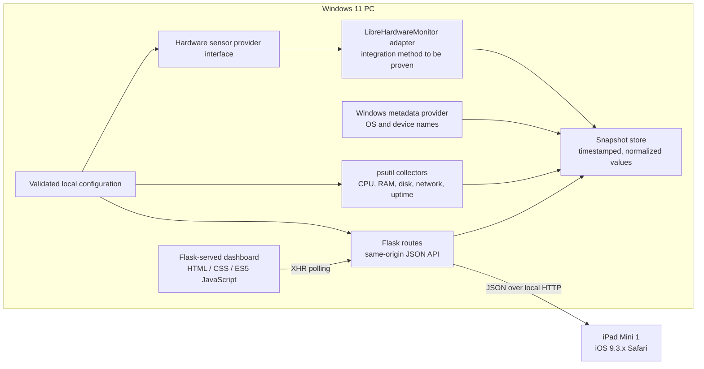

# PCResourceMonitor Architecture

**Status:** Proposed design for review  
**Project root:** `PCResourceMonitor`  
**Scope:** Architecture only; no application code is defined by this document.

## 1. Goals and design constraints

PCResourceMonitor will run on a Windows 11 PC and provide a read-only, local JSON API and dashboard for an iPad Mini 1 running iOS 9.3.x Safari. The PC collects all metrics; the iPad renders them. The interface targets landscape use at 1024 × 768, polls over HTTP, and must remain useful when optional sensors are unavailable.

The proposal follows the project requirements in the root `AGENTS.md` and `README.md`: Python 3.11, Flask, psutil, LibreHardwareMonitor (LHM) or a sensor bridge, plain HTML/CSS/JavaScript, and incremental development. Hardware inventory supplied by the owner: AMD Ryzen 5 9600X (6 cores / 12 threads), NVIDIA GeForce RTX 5060 Ti dedicated GPU, and integrated AMD Radeon(TM) Graphics. These names guide provider validation but do not prove which sensors the installed drivers expose.

### Decision labels used here

- **Requirement:** Explicitly requested by the project.
- **Proposal:** Recommended design choice, subject to approval.
- **Needs testing:** Depends on the actual PC, iPad, network, or software versions and must be verified.

## 2. Proposed application architecture

Keep the Python backend responsible for collection, normalization, caching, security checks, and API responses. Keep the frontend as static files in its own directory. A small Flask application can serve both the dashboard and same-origin API, avoiding CORS and external frontend dependencies.

The collectors update a shared in-memory snapshot on a timer. API requests read the latest snapshot and do not directly query hardware. This keeps slow or unreliable sensor reads out of the HTTP request path.



### Proposed package and module responsibilities

Names below are a proposed decomposition, not files that exist yet.

| Module | Responsibility |
|---|---|
| `backend/app.py` | Application factory/startup wiring; load validated configuration, instantiate providers, register routes, and start/stop sampling cleanly. |
| `backend/config.py` | Read configuration from safe defaults and a local configuration file/environment; validate bind address, port, polling interval, allowed client subnets, and enabled providers. Never contain passwords or committed secrets. |
| `backend/api/routes.py` | Define dashboard route and versioned read-only API endpoints; return consistent JSON and HTTP status codes. |
| `backend/api/serialization.py` | Normalize numeric units, timestamps, missing values, and error metadata into the public response schema. |
| `backend/api/access.py` | Enforce configured source-IP/CIDR allowlist and request/rate constraints before exposing dashboard/API responses. Must not trust a client-supplied forwarding header. |
| `backend/monitoring/sampler.py` | Run scheduled collection independently from requests; protect snapshot updates with a lock; record per-provider update time and errors. |
| `backend/monitoring/snapshot.py` | Hold the latest immutable or safely copied normalized data snapshot and sequence number. |
| `backend/monitoring/cpu.py` | Collect total and per-core CPU utilization and frequency using psutil where available; avoid blocking API requests during the first utilization sample. |
| `backend/monitoring/memory.py` | Collect physical memory total, used, available, and percentage with psutil. |
| `backend/monitoring/storage.py` | Enumerate eligible mounted volumes, collect capacity/free space, and calculate disk read/write rates from counter deltas. Handle inaccessible/removable volumes. |
| `backend/monitoring/network.py` | Enumerate interfaces and collect byte counters; compute download/upload rates from deltas, identify counter resets, and distinguish interface totals from internet throughput. |
| `backend/monitoring/system.py` | Collect OS version, hostname/CPU identification where safely available, boot time/uptime, and static metadata. Avoid slow WMI calls in the sampling hot path. |
| `backend/monitoring/hardware.py` | Define provider contract and normalize LHM sensor identities, types, units, freshness, and source errors. A provider must report absent values rather than substitute estimates. |
| `backend/monitoring/gpus.py` | Enumerate all display adapters; display the actual device name and correlate provider readings using adapter LUID plus hardware identity where available. Never assign a GPU's identity by list index; leave ambiguous readings unmatched. |
| `backend/monitoring/providers/nvidia_nvml.py` | Optional NVIDIA NVML provider for supported RTX 5060 Ti fields. Probe each metric independently because GeForce/RTX support is limited and can vary by driver. |
| `backend/monitoring/providers/amd_adlx.py` | Optional AMD ADLX provider for Radeon metrics where supported by the installed AMD driver and adapter. Keep the vendor integration behind the provider interface. |
| `backend/monitoring/providers/windows_gpu.py` | Optional Windows DXGI/GPU-engine provider for adapter identity, memory class, and per-adapter engine activity; preserve the distinction between process-specific and adapter-wide readings. |
| `backend/monitoring/windows_info.py` | Optional Windows-specific provider for metadata not reliably exposed by psutil; isolate calls to Windows APIs/WMI and provide timeouts/fallbacks. |
| `frontend/index.html` | Semantic dashboard shell and connection/sensor status areas; provide viewport settings and accessible labels. |
| `frontend/css/` | Base layout and theme, with ordinary solid/transparent color fallbacks before optional blur/glow enhancements. |
| `frontend/js/` | ES5-compatible XHR poller, schema validation, render functions, and stale/offline state handling. |
| `frontend/assets/` | Lightweight local SVG icons only; no remote assets or fonts required. |

**Proposal:** Use a provider interface for LHM and keep the rest of the backend independent of how the .NET library is accessed. An initial compatibility spike should compare direct Python/.NET interop with a small isolated .NET sensor bridge that emits JSON. Pick one only after checking supported Python/.NET runtimes, process permissions, distribution, and the target machine. A bridge process offers fault isolation but adds another runtime/process; in-process interop has a smaller process footprint but higher runtime compatibility risk.

**Proposal:** Run a production-capable WSGI server on Windows (for example, Waitress) rather than Flask's development server. Its suitability, version, and dependency cost are implementation-stage decisions. Do not expose the development server as a network service.

## 3. Sampling and data freshness

- **Proposal:** Sample fast counters (CPU, memory, network and disk I/O) about once per second, configurable within a conservative range. UI polling can be about once per second too; avoid sampling hardware once for every browser request.
- Rate metrics are calculated from successive cumulative counter samples: `(new_bytes - old_bytes) / elapsed_seconds`. If a counter decreases, elapsed time is invalid, or a sample is missing, publish `null` for that rate until a valid new baseline exists.
- Static metadata can refresh less frequently. Hardware sensors should refresh at a rate supported by the provider and hardware; do not force one-second sensor access if it stalls or causes load.
- Every section includes the source sample time and status. If collection fails, retain the last known value only with an explicit stale state and age; otherwise send `null`.
- A provider timeout or exception must not prevent other providers from updating.

## 4. HTTP API contract

All API responses use UTF-8 JSON, have stable field names and explicit units, and are served same-origin with the dashboard. The API is read-only.

### Endpoints

| Method and path | Purpose |
|---|---|
| `GET /` | Serve the dashboard shell. |
| `GET /api/v1/status` | Return the complete latest snapshot for one simple polling request. |
| `GET /api/v1/health` | Report whether the API is running and when monitoring providers last sampled; do not include sensitive system details. |
| `GET /api/v1/system` | Optional focused system metadata endpoint; can be omitted initially if `status` meets all needs. |

Use `Cache-Control: no-store` for live API responses. No WebSocket is required. Unknown routes return a small JSON error for API paths. Avoid permissive CORS because the intended UI and API are same-origin.

### Example: `GET /api/v1/status`

```json
{
  "schema_version": 1,
  "sequence": 1842,
  "generated_at": "2026-11-16T12:34:56Z",
  "overall_status": "partial",
  "sections": {
    "cpu": {
      "status": "ok",
      "sampled_at": "2026-11-16T12:34:56Z",
      "usage_percent": 23.4,
      "per_core_percent": [18.2, 28.6],
      "frequency_mhz": 3591.0,
      "temperature_c": {
        "value": null,
        "status": "unavailable",
        "reason": "No supported CPU temperature sensor was reported."
      }
    },
    "memory": {
      "status": "ok",
      "sampled_at": "2026-11-16T12:34:56Z",
      "total_bytes": 17179869184,
      "used_bytes": 9126805504,
      "available_bytes": 8053063680,
      "usage_percent": 53.1
    },
    "gpus": {
      "status": "partial",
      "sampled_at": null,
      "devices": [
        {
          "adapter_key": null,
          "name": "NVIDIA GeForce RTX 5060 Ti",
          "adapter_type": "dedicated",
          "provider": "nvml",
          "utilization_percent": { "value": null, "status": "unavailable", "reason": "Not sampled; validate support on this PC." },
          "temperature_c": { "value": null, "status": "unavailable", "reason": "Not sampled; validate support on this PC." },
          "memory": {
            "dedicated": { "used_bytes": null, "total_bytes": null, "status": "unavailable" },
            "shared_system": { "used_bytes": null, "budget_bytes": null, "status": "unavailable" }
          }
        },
        {
          "adapter_key": null,
          "name": "AMD Radeon(TM) Graphics",
          "adapter_type": "integrated",
          "provider": "windows_gpu",
          "utilization_percent": { "value": null, "status": "unavailable", "reason": "Not sampled; validate support on this PC." },
          "temperature_c": { "value": null, "status": "unavailable", "reason": "No supported sensor has been confirmed." },
          "memory": {
            "dedicated": { "used_bytes": null, "total_bytes": null, "status": "unavailable" },
            "shared_system": { "used_bytes": null, "budget_bytes": null, "status": "unavailable" }
          }
        }
      ]
    },
    "storage": {
      "status": "ok",
      "sampled_at": "2026-11-16T12:34:56Z",
      "volumes": [
        {
          "mount": "C:\\",
          "total_bytes": 1024209543168,
          "used_bytes": 521123221504,
          "free_bytes": 503086321664,
          "usage_percent": 50.9,
          "read_bytes_per_second": 1048576,
          "write_bytes_per_second": 524288
        }
      ]
    },
    "network": {
      "status": "ok",
      "sampled_at": "2026-11-16T12:34:56Z",
      "interfaces": [
        {
          "name": "Example Ethernet",
          "is_up": true,
          "download_bytes_per_second": 125000,
          "upload_bytes_per_second": 18000
        }
      ],
      "rate_scope": "per-interface cumulative OS counters"
    },
    "system": {
      "status": "ok",
      "sampled_at": "2026-11-16T12:34:50Z",
      "hostname": "EXAMPLE-PC",
      "os": "Windows 11",
      "cpu_name": null,
      "uptime_seconds": 86400
    }
  }
}
```

The example is illustrative, not a live report. GPU names come from the supplied inventory; their metric values are deliberately null until measured. Other names, counters, rates, timestamps, and sensors must come from the actual machine. The per-core array length varies by CPU. The plural `gpus.devices` array supports multiple adapters.

### Missing values, stale values, and errors

- Known but unavailable measurements use `value: null` (or a nullable field in a typed object), `status: "unavailable"`, and a plain-language `reason`.
- A previous reading that is still displayed is marked `status: "stale"` and includes `age_seconds`; the UI must visually indicate staleness.
- A collection problem uses section status `"error"` with a safe diagnostic code/message. Do not expose stack traces or internal paths to clients.
- Overall status is `"ok"` only when required core sections are fresh; `"partial"` if optional/other sections are unavailable; `"error"` if no usable current snapshot exists.
- Rates use bytes per second and temperatures degrees Celsius. Percentages are 0–100. Timestamps are UTC ISO 8601.

## 5. Frontend architecture and communication flow

The frontend is a small single-page dashboard without a framework:

1. Safari loads the dashboard shell from the PC's Flask-served origin.
2. An ES5 JavaScript poller issues `XMLHttpRequest` to `/api/v1/status` at a configurable interval.
3. The poller enforces a request timeout, ignores an out-of-order response if one occurs, checks the schema version, and sends the parsed snapshot to render functions.
4. Separate render functions update CPU, memory, GPU, storage, network, system, and connection status; user-visible strings are inserted as text, not HTML.
5. On timeout/network loss, retain the last screen briefly, mark its timestamp as stale, and show a clear disconnected/reconnecting state. Do not turn missing readings into zero.
6. Use a modest amount of DOM and SVG; avoid per-frame redraws. CSS transitions should be short and optional.

The layout should prioritize glanceable readings in landscape, with a sensible narrow/portrait fallback rather than assuming the browser's viewport is exactly the device's nominal pixel resolution.

## 6. iOS 9.3.x Safari compatibility plan

The first-generation iPad mini has a 1024 × 768 display resolution according to Apple's specifications, but Safari's actual CSS viewport depends on orientation, browser chrome, zoom, and viewport configuration. Measure on the real device; treat 1024 × 768 as the design target, not a guaranteed CSS viewport. [Apple iPad mini specifications](https://support.apple.com/en-ie/111978)

- Use `<meta name="viewport" content="width=device-width, initial-scale=1">` and test real landscape Safari; avoid relying on modern viewport units such as `dvh`.
- Write JavaScript in ES5 syntax: `var`, functions, ordinary arrays/objects, and `XMLHttpRequest`. Avoid modules, `fetch`, promises, arrow functions, `let/const`, template literals, optional chaining, and other post-iOS-9 APIs unless feature-detected and unnecessary to core use.
- Use basic CSS layout with media queries and well-supported flexbox only after testing on iOS 9. Keep a block/inline-block fallback. Avoid CSS Grid, custom properties, and `backdrop-filter` as requirements.
- Glass styling must degrade to opaque or translucent `rgba()` panels and gradients. Add blur/glow only as progressive enhancement with `-webkit-` prefixes where applicable and test support; contrast and readability must remain without it.
- Use simple SVG paths/shapes and CSS transitions. Avoid filters, complex masks, large SVGs, remote web fonts, and animation effects that need continuous repainting.
- Keep all assets local, lightweight, and same-origin. Test tap targets, text scaling, touch scrolling, orientation change, reconnection, and Safari's browser chrome effects.
- Build a static compatibility test page early and test on the actual iPad. Desktop user-agent emulation alone cannot confirm iOS 9 behavior.

## 7. Network and USB feasibility

### Confirmed from documentation

Apple documents USB Personal Hotspot connectivity between Windows and an iPad **with Wi‑Fi + Cellular**, requiring Apple Devices or iTunes on Windows and the iPad's Personal Hotspot / trust flow. Apple also states that the iPad's cellular connection is what the connected computer uses. This is a documented **iPad-to-PC internet-sharing** path. [Apple: Share internet from a Wi‑Fi + Cellular iPad](https://support.apple.com/en-euro/guide/ipad/ipadb2c87b68/27/ipados/27)

Apple's iPad mini specifications distinguish Wi‑Fi and Wi‑Fi + Cellular models. Therefore, Personal Hotspot is not a path for a Wi‑Fi-only iPad mini. [Apple: iPad mini technical specifications](https://support.apple.com/en-ie/111978)

### Not confirmed for this project

The requested topology is the reverse: Windows runs the monitoring server and the iPad must connect as a USB network client to that server. Apple's cited USB instructions do not establish that a Windows PC can expose a generic USB Ethernet/network interface to an iPad mini over Lightning. A Lightning cable's charging/data connection and device pairing do not, by themselves, create an IP route usable by Safari.

**Conclusion:** Treat Windows-to-iPad USB networking as an unproven experiment, not a supported plan. A third-party adapter/driver or special USB networking software might change feasibility, but none is assumed or selected here. Do not change Windows networking settings or install such software without a separate, approved test plan.

### Experiment outline for a later approved phase

1. Identify the iPad mini model (Wi‑Fi vs Cellular, generation/model identifier) and iOS version.
2. Connect the actual iPad to the actual Windows PC using the existing cable; observe whether Windows enumerates any network adapter, not merely an Apple mobile-device/charging device.
3. Check for a usable IP address, route, and bidirectional reachability without changing firewall or adapter configuration.
4. Verify Safari can open a temporary local-only test endpoint on the PC.
5. Record required drivers/software, permissions, stability after reconnect/reboot, and any public-network exposure.
6. If any step fails or requires unsupported driver work, stop and use Wi‑Fi.

**Wi‑Fi fallback:** Connect PC and iPad to the same trusted local Wi‑Fi network, then access the PC's selected local IP address and port. The iPad can remain a dashboard client; it does not need its own cellular capability.

## 8. Safe server configuration

- Default to binding only to loopback (`127.0.0.1`) until a user explicitly configures and tests remote access. For iPad access, bind to a specific chosen private-interface address where practical; avoid unconditional `0.0.0.0`.
- Require an explicit port and allowed client subnet/CIDR list for remote mode. Validate addresses and reject invalid/wildcard public binds unless there is an explicit later design decision.
- Enforce source IP restrictions in the application and recommend a narrowly scoped Windows Firewall inbound rule for the selected interface/profile, port, and iPad/subnet. Do not disable Windows Firewall or change its profile automatically. Windows Firewall supports profile and address/port-based rules. [Microsoft: Windows Firewall overview](https://learn.microsoft.com/windows/security/operating-system-security/network-security/windows-firewall)
- Never trust `X-Forwarded-For` on a direct local server. Do not enable CORS for arbitrary origins. Serve dashboard and API from the same origin.
- Expose only read-only metrics endpoints; no process termination, command execution, settings changes, or filesystem browsing.
- Do not include secrets in URLs, source, or logs. Local network/IP allowlisting reduces exposure but is not authentication against every client on a shared or compromised LAN. If the network is not fully trusted, add an explicit authentication/TLS design before remote use.
- Validate Host/request handling, set request-size limits, bound polling frequency, and log concise access/provider status without sensitive values.
- Do not claim that a private IP or USB link automatically means the service cannot be routed publicly. Confirm interface, firewall, and routing behavior during the network test.

## 9. Sensor and metric limitations

| Data | Proposed source | Limitations and handling |
|---|---|---|
| CPU utilization and per-core utilization | psutil CPU counters | First percentage sample needs a baseline; per-core count depends on CPU. Use asynchronous interval sampling, not a blocking HTTP call. |
| CPU clock | psutil frequency where supported; otherwise LHM | Report the provider and freshness. Frequency can be current/effective and may vary rapidly. |
| CPU temperature (Ryzen 5 9600X) | First choice to validate: LHM CPU sensor through the hardware provider. Evaluate another Windows/AMD provider only if LHM reports none. | LHM release history includes Ryzen 9000 support, but a specific issue reports a Ryzen 5 9600X with no CPU temperature. That does not prove the current build fails or works on this PC. Motherboard/BIOS, LHM build, permissions, and sensor labels may matter. Compare with an independent local sensor display; otherwise return unavailable. psutil temperature sensors are not available on Windows. [LHM release history](https://github.com/LibreHardwareMonitor/LibreHardwareMonitor/releases), [9600X issue](https://github.com/LibreHardwareMonitor/LibreHardwareMonitor/issues/1418), [psutil platform support](https://psutil.io/shell-equivalents/) |
| RAM | psutil virtual memory | Physical memory statistics are generally available; define used/available fields exactly and avoid mixing commit/pagefile values with physical RAM. |
| NVIDIA GeForce RTX 5060 Ti | Proposed primary: NVML through the installed NVIDIA driver; fallback/cross-check: Windows GPU engine counters and LHM | NVML APIs include utilization, temperature, and memory queries, but NVIDIA documents limited support for newer GeForce/RTX consumer GPUs. Confirm the installed driver exposes NVML and probe each field independently. A successful name query does not imply all telemetry works. [NVML API reference](https://docs.nvidia.com/deploy/nvml-api/latest/nvml-api-reference.html) |
| AMD Radeon(TM) integrated GPU | Proposed baseline: Windows adapter enumeration and GPU engine counters; AMD-specific option: ADLX; LHM as a common provider to evaluate | Correlate activity to the adapter LUID, not an enumeration index. ADLX exposes usage, temperature, clocks, and dedicated VRAM metrics for supported Radeon adapters; compatibility conditions include AMD Radeon graphics based on RDNA or newer. Confirm the installed driver/API supports this 9600X iGPU and each metric. Generic Windows activity counters may not provide temperature. [ADLX metrics](https://gpuopen.com/manuals/adlx/adlx-sdk-references/adlx-interfaces/performance-monitoring/iadlxgpumetrics/), [ADLX compatibility](https://gpuopen.com/manuals/adlx/programming-with-adlx/adlx-programming-guide/specifications/compatibility/) |
| Multi-GPU identity | Windows DXGI/DXCore adapter enumeration, enriched by vendor providers | Show each actual reported device name. Correlate using adapter LUID plus vendor/device/subsystem identity when available; never assume GPU 0 is a specific card or that indexes are stable. If a provider cannot be matched unambiguously, do not merge its readings. [DXGI adapter description](https://learn.microsoft.com/en-us/windows/win32/api/dxgi/ns-dxgi-dxgi_adapter_desc1) |
| Dedicated vs shared graphics memory | DXGI adapter description and appropriate vendor/API counters | Return separate `dedicated` and `shared_system` fields. DXGI exposes dedicated video memory and shared system memory separately; an iGPU's shared RAM allowance is not dedicated VRAM. Label capacity, budget, and current use distinctly. DXGI `QueryVideoMemoryInfo` is process usage/budget, not necessarily total adapter usage. [DXGI adapter memory fields](https://learn.microsoft.com/en-us/windows/win32/api/dxgi/ns-dxgi-dxgi_adapter_desc1), [DXGI memory query](https://learn.microsoft.com/en-us/windows/win32/api/dxgi1_4/nf-dxgi1_4-idxgiadapter3-queryvideomemoryinfo) |
| Disk capacity/free space | psutil per mounted volume | Access-denied, disconnected, removable, or system mounts can fail; skip or report individually with error status. |
| Disk read/write rates | psutil cumulative I/O counters | Windows may require disk performance counters to be enabled for I/O counters; project must not run system-changing commands automatically. If counters unavailable, keep capacity data and mark rates unavailable. [psutil disk I/O docs](https://psutil.readthedocs.io/stable/) |
| Network rates | psutil interface byte counters | These are per-interface OS counters, not necessarily internet traffic. Virtual/VPN/adapters and loopback can skew totals; let configuration exclude interfaces and show interface identity. |
| System/CPU/GPU names | Windows metadata APIs, psutil, and hardware provider | Device naming can be unavailable or costly to query. Cache static fields and avoid hardcoded assumptions. |
| Temperature/fan/voltage sensors in general | LHM | LHM supports many boards and CPU/GPU families but explicitly notes hardware/vendor differences; sensor coverage on the target machine must be validated. [LibreHardwareMonitor README](https://github.com/LibreHardwareMonitor/LibreHardwareMonitor/blob/master/README.md) |

The UI should display “Unavailable” with an optional short reason, not a fake number, zero, blank graph, or interpolated estimate. Distinguish “not supported,” “not detected,” “permission denied,” and “temporarily stale” where the provider can identify the cause.

## 10. Testing strategy

Testing is staged and covers contracts, failure behavior, security boundaries, device compatibility, and actual hardware. Do not add tests until implementation work is approved; this section is the proposed strategy.

1. **Pure unit tests:** Validate normalization, unit conversions, rate calculations, counter resets, null/stale states, schema versioning, and config validation using simulated provider data.
2. **Provider tests on Windows:** Compare CPU/memory/disk/network collection to Windows tools; verify CPU first-sample behavior; enumerate real interfaces/volumes; confirm unavailable metrics fail gracefully. Compare LHM readings with its own UI on the same PC, without treating either as a medical/safety instrument.
3. **API tests:** Check status codes, JSON schema, timestamps, cache headers, health endpoint, malformed/unknown routes, slow/failing providers, and no stack traces. Assert no per-request hardware scans.
4. **Security tests:** Verify loopback default, configured bind behavior, allowed/denied client addresses, no arbitrary CORS, no trusted forwarded headers, read-only endpoints, rate limits, and scoped firewall instructions. Network exposure checks must be authorized and local.
5. **Frontend tests:** Test with fixture JSON for full, partial, stale, offline, malformed, and unknown schema states. Verify text insertion is safe and missing readings do not render as zero.
6. **Layout and compatibility:** Test at 1024 × 768 and representative smaller viewports, both orientations, zoom/text scaling, and actual iOS 9.3.x Safari. Check CSS fallback with blur disabled, XHR timeout/reconnect, touch target size, and low repaint/load.
7. **Network experiment:** Only after approval, run the USB checklist above on the actual devices; test Wi-Fi fallback separately and verify the service is unreachable from untrusted interfaces/subnets.
8. **Soak/reliability:** Run for several hours; watch memory, sampler drift, stale recovery, reconnect handling, and behavior after sleep/resume or interface changes.

## 11. Phased implementation roadmap

1. **Approve architecture and settle environment questions.** Confirm PC and iPad model details, installation constraints, and network test authorization.
2. **Create architecture skeleton.** Add backend configuration/app factory, module boundaries, empty frontend shell, and documented local-only run instructions. No sensor complexity yet.
3. **Implement core psutil providers and snapshot contract.** CPU, memory, storage capacity/I/O, network counters/rates, and system metadata; verify actual Windows behavior.
4. **Implement API and access controls.** Versioned read-only endpoints, loopback-safe configuration, allowlist validation, and integration tests.
5. **Run the hardware-provider spike.** Validate Ryzen 5 9600X temperature through LHM; probe NVML fields on the RTX 5060 Ti; enumerate both adapters by name/LUID; check Windows GPU activity/memory; and evaluate ADLX for AMD Radeon(TM) Graphics. Choose Python interop or an isolated bridge based on measured results.
6. **Build the legacy-compatible dashboard.** Add ES5 XHR polling, per-module rendering, offline/stale states, and glass styling with solid fallback.
7. **Validate at target device and display size.** Fix real Safari viewport, layout, touch, and performance issues.
8. **Test connectivity paths.** Try USB only under an approved controlled test; deploy the Wi-Fi path with a narrow firewall rule if USB is unavailable.
9. **Reliability and documentation pass.** Perform soak tests, document launch/configuration/troubleshooting, and record sensor coverage and remaining limitations.

## 12. Unresolved technical questions

These are required to finalize implementation details; none should be guessed:

- What motherboard/system model, BIOS version, Windows build, NVIDIA driver version, and AMD display driver version are installed? (CPU/GPU models have now been supplied.)
- Which LHM build is available, if any, and is using a .NET runtime / Python.NET / a separate bridge acceptable? Can an LHM report be compared against an independent reading on this PC?
- Do NVML calls on this RTX 5060 Ti return name, utilization, temperature, and memory independently? Which fields return unsupported/error?
- Does the installed AMD driver expose the iGPU through ADLX, and does Windows expose its engine activity and memory counters by adapter identity?
- Can NVIDIA NVML be mapped unambiguously to the RTX 5060 Ti Windows adapter, and the AMD provider to AMD Radeon(TM) Graphics?
- Which dedicated/shared memory capacity, budget, and usage values are available for both adapters, especially the shared-memory budget/use for the AMD iGPU?
- What is the exact iPad model identifier (Wi‑Fi or Wi‑Fi + Cellular) and confirmed iOS version?
- Can the PC and iPad join the same trusted Wi‑Fi network? Is router configuration off-limits?
- Is the PC managed by organizational policy, and are local firewall rules or optional software installs allowed later?
- Should remote mode require a shared access token or remain restricted to one configured client/subnet on a trusted private network?
- Which drives and network interfaces should be shown or excluded?
- Is a one-second display refresh appropriate, or is lower CPU/network overhead preferred?
- What launch model is preferred later: manual foreground process, startup shortcut, or Windows service? Service installation would need separate review and may affect sensor permissions.
- Does the project need to operate offline with no access to package registries after dependencies are prepared?

## 13. Key risks

| Risk | Impact | Mitigation |
|---|---|---|
| USB networking direction is unsupported by standard iPad workflow | USB experiment fails or needs third-party components | Treat as optional experiment; make same-LAN Wi-Fi the supported fallback. |
| LHM/.NET runtime interop mismatch | Sensor provider cannot start or is fragile | Isolate behind provider interface; perform compatibility spike before choosing integration. |
| LHM does not expose Ryzen 5 9600X temperature on this motherboard/BIOS | CPU temperature remains unavailable although usage/frequency work | Test the actual LHM build and sensor source; evaluate another supported AMD provider, otherwise show unavailable. |
| NVML support is limited for GeForce/RTX consumer cards | Some RTX 5060 Ti fields may be unsupported | Probe each call independently; use a fallback only when its semantics match, otherwise mark that field unavailable. |
| GPU providers enumerate adapters differently | A metric may be attached to the wrong card | Correlate by adapter LUID and hardware identity; never depend on fixed indexes; keep ambiguous samples unmatched. |
| Integrated shared memory is reported as dedicated VRAM | Dashboard shows misleading iGPU memory | Separate dedicated and shared-system fields, and label capacity/budget/current use distinctly. |
| Sensor coverage varies by hardware and driver | Some CPU/GPU metrics remain unavailable | Report per-sensor status honestly; preserve the rest of the dashboard. |
| Legacy Safari lacks modern CSS/JS features | Blank/broken UI or unreadable panels | ES5 + XHR, CSS fallbacks, actual-device testing, no required blur. |
| Binding broadly or weak access control exposes host details | Local data leakage or unwanted access | Loopback default, specific private bind, source allowlist, scoped firewall, read-only API. |
| Counter collection or hardware queries stall | UI freezes or readings become stale | Background sampling, timeouts/isolation, last-good sample marked stale. |
| Windows disk performance counters may be unavailable | Disk activity rates missing | Do not alter system automatically; report rates unavailable and retain disk capacity metrics. |
| Old tablet/OS or network stack instability | Intermittent display or degraded performance | Use low-payload JSON, simple DOM updates, reconnection handling, and soak/device testing. |

## 14. Research sources

- Apple, [Share internet from a Wi‑Fi + Cellular iPad with Personal Hotspot](https://support.apple.com/en-euro/guide/ipad/ipadb2c87b68/27/ipados/27)
- Apple, [iPad mini technical specifications](https://support.apple.com/en-ie/111978)
- Microsoft, [Windows Firewall overview](https://learn.microsoft.com/windows/security/operating-system-security/network-security/windows-firewall)
- psutil, [Windows platform equivalents and sensor support](https://psutil.io/shell-equivalents/)
- psutil, [stable API documentation](https://psutil.readthedocs.io/stable/)
- LibreHardwareMonitor, [project README and supported integration targets](https://github.com/LibreHardwareMonitor/LibreHardwareMonitor/blob/master/README.md)
- LibreHardwareMonitor, [library project target frameworks](https://github.com/LibreHardwareMonitor/LibreHardwareMonitor/blob/master/LibreHardwareMonitorLib/LibreHardwareMonitorLib.csproj)
- NVIDIA, [NVML API reference](https://docs.nvidia.com/deploy/nvml-api/latest/nvml-api-reference.html)
- AMD, [Ryzen desktop processor specifications](https://www.amd.com/en/products/processors/desktops/ryzen.html)
- AMD GPUOpen, [ADLX compatibility](https://gpuopen.com/manuals/adlx/programming-with-adlx/adlx-programming-guide/specifications/compatibility/) and [GPU metrics interface](https://gpuopen.com/manuals/adlx/adlx-sdk-references/adlx-interfaces/performance-monitoring/iadlxgpumetrics/)
- Microsoft, [DXGI adapter identity and memory fields](https://learn.microsoft.com/en-us/windows/win32/api/dxgi/ns-dxgi-dxgi_adapter_desc1) and [DXGI video-memory budget query](https://learn.microsoft.com/en-us/windows/win32/api/dxgi1_4/nf-dxgi1_4-idxgiadapter3-queryvideomemoryinfo)
- LibreHardwareMonitor, [Ryzen 9000 release history](https://github.com/LibreHardwareMonitor/LibreHardwareMonitor/releases) and [Ryzen 5 9600X temperature issue](https://github.com/LibreHardwareMonitor/LibreHardwareMonitor/issues/1418)

