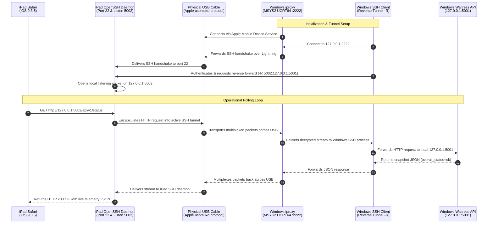

# USB-Only Communication Architecture for PCResourceMonitor

## 1. Overview

PCResourceMonitor supports a dedicated, high-security, **USB-only tethered connection** between the host Windows 11 PC and an iPad Mini 1 (iOS 9.3.5). 

This architecture bypasses local Wi-Fi, Ethernet, and router infrastructure entirely. The Windows monitoring server (Waitress/Flask) binds strictly to the loopback interface (`127.0.0.1`), ensuring the API service is not directly exposed to local area networks (LAN) or public interfaces. By leveraging Apple's USB multiplexing protocol (`usbmuxd`) and an SSH reverse tunnel, the iPad accesses the PC's live telemetry endpoints as if the server were running locally on the tablet (`http://127.0.0.1:5002`).

> [!NOTE]
> **Credential Security Notice:**  
> The device owner has already updated the iPad's `root` account password to a secure value. The secondary `mobile` account password should also be verified and maintained using the `passwd` utility. In accordance with security practices, authentication credentials must never be documented, hardcoded, or stored in project configuration files or version control. All SSH credentials remain securely managed directly by the device owner.

---

## 2. Hardware and Environment Specifications

### 2.1 Target Client Hardware
- **Device:** iPad Mini (1st Generation)
- **Model Identifier:** `iPad2,5`
- **Display Resolution:** 1024 × 768 (Physical)
- **Operating System:** iOS 9.3.5 (Build 13G36)
- **Environment:** Carbon Jailbreak
- **Device Daemon:** OpenSSH (installed via Cydia / APT repository)

### 2.2 Host System Components
- **Host OS:** Windows 11 Pro 64-bit
- **USB Service:** Apple Mobile Device Service (AMDS / Apple Mobile Device Support)
- **POSIX Subsystem:** MSYS2 UCRT64
- **USB Multiplexing Libraries:**
  - `libusbmuxd` version 2.1.1
  - `iproxy` version 2.1.1 (from `libusbmuxd-tools`)
- **SSH Client:** Windows OpenSSH client (`OpenSSH_for_Windows`)

> [!NOTE]
> **Package History:**  
> MSYS2 UCRT64, `libusbmuxd`, and `iproxy` were installed previously during the USB feasibility investigation phase. No additional software packages or system modifications were installed during the documentation task.

---

## 3. Communication Architecture & Connection Flow

The link consists of a two-stage multiplexed reverse tunnel over the physical Lightning-to-USB cable:



### 3.1 Multiplexing and Directionality Details
1. **Not a Conventional USB Ethernet Interface:**
   - This setup does **not** create a virtual network adapter, NDIS/CDC-ECM interface, or IP subnet on either Windows or the iPad.
   - All communication takes place strictly over Apple's proprietary USB multiplexing protocol (`usbmuxd`) via the Lightning cable.
2. **Tunnel Initiation (Windows Initiates to iPad):**
   - The Apple Mobile Device Service on Windows maintains a low-level USB driver link to the device.
   - `iproxy` listens on Windows loopback (`127.0.0.1:2222`) and forwards TCP connections across the USB bus directly to TCP port 22 on the iPad.
   - The **Windows host initiates** the outbound SSH connection through `iproxy` to the iPad's OpenSSH daemon.
3. **Reverse-Forward Listener on iPad Port 5002:**
   - Through the SSH command `-R 5002:127.0.0.1:5001`, the **iPad SSH daemon creates and manages a local reverse-forward listener** on iPad loopback (`127.0.0.1:5002`).
4. **Client Requests (iPad Safari to Windows Waitress):**
   - iPad Mobile Safari issues HTTP requests directly to `http://127.0.0.1:5002`.
   - The iPad kernel delivers these requests to the local iPad SSH daemon, which multiplexes the traffic through the established SSH connection across the physical USB Lightning link.
   - The Windows SSH client receives the data and forwards it to the local Waitress WSGI server listening on `127.0.0.1:5001`.
   - The Waitress WSGI server on Windows and the reverse-forward listener on iOS both bind strictly to loopback (`127.0.0.1`), ensuring neither endpoint is directly exposed through LAN or public network interfaces.

---

## 4. Step-by-Step Verified Connection Procedure

### Step 1: Physical Setup
1. Connect the iPad Mini 1 to the Windows 11 PC using an authentic Lightning-to-USB cable.
2. Unlock the iPad screen and tap **Trust This Computer** if prompted.

### Step 2: Start USB Multiplexing Proxy (`iproxy`)
In an **MSYS2 UCRT64** terminal on Windows:
```bash
iproxy 2222 22
```
*Expected output:*
```text
waiting for connection...
```
Leave this terminal window open.

### Step 3: Verify Direct SSH Connection (Optional diagnostic)
In a Windows PowerShell terminal:
```powershell
ssh -oHostKeyAlgorithms=+ssh-rsa -p 2222 root@127.0.0.1
```
*Note:* Legacy iOS 9.3.5 OpenSSH requires enabling RSA host keys via `-oHostKeyAlgorithms=+ssh-rsa`. When prompted, authenticate with the configured device credentials, verify successful shell access, then type `exit`.

### Step 4: Establish the Reverse Tunnel
In a Windows PowerShell terminal:
```powershell
ssh -oHostKeyAlgorithms=+ssh-rsa -R 5002:127.0.0.1:5001 -p 2222 root@127.0.0.1
```
When prompted, authenticate with the configured device credentials. Leave this session active; this maintains the reverse forward from iPad `5002` to Windows `5001`.

### Step 5: Access Telemetry on iPad Safari
Open Mobile Safari on the iPad Mini 1 and navigate to:
1. **Health Check:**
   ```text
   http://127.0.0.1:5002/api/v1/health
   ```
2. **Live Telemetry Snapshot:**
   ```text
   http://127.0.0.1:5002/api/v1/status
   ```

---

## 5. Verification Results

Live verification confirmed the following operational telemetry delivered over USB into Safari on iOS 9.3.5:

1. **Service Health (`/api/v1/health`):**
   - HTTP Status: `200 OK`
   - Content:
     ```json
     {
       "last_sequence": 42,
       "overall_status": "ok",
       "sampler": {
         "interval_seconds": 1.0,
         "is_running": true,
         "last_sequence": 42
       },
       "status": "healthy"
     }
     ```
2. **Full Telemetry Delivery (`/api/v1/status`):**
   - HTTP Status: `200 OK`
   - Overall Status: `"ok"`
   - Sequential updates: Upon browser refresh, `sequence` incremented monotonically and `generated_at` / `sampled_at` timestamps advanced in real time.
   - Hardware metrics verified in iPad Safari:
     - **CPU:** Real-time usage percentage, per-core utilization array across all 12 logical cores, and clock frequency.
     - **Memory:** Physical memory total (16 GB), used bytes, available bytes, and percentage.
     - **Storage:** Fixed drive partitions (`C:\` and `D:\`) with capacity and free space.
     - **Network:** Active network interface byte counters and throughput rates.
     - **GPUs:** Dual GPU discovery including dedicated `NVIDIA GeForce RTX 5060 Ti` (with live utilization, temperature, VRAM, and power) and `AMD Radeon(TM) Graphics` (with DXGI identity and memory budget).

---

## 6. Known Limitations & Operational Considerations

1. **Interactive Session Persistence:**
   - Both the `iproxy` process (in MSYS2) and the reverse SSH tunnel session (in PowerShell) must remain running in their respective windows. Closing either window closes the reverse port forward.
2. **Reconnection Handling:**
   - Unplugging the Lightning cable drops the USB multiplexer stream. Reconnecting the cable requires re-launching `iproxy` and re-establishing the reverse SSH forward.
3. **Automated Startup:**
   - Automatic execution as a background Windows service or task is not yet configured. The connection currently requires manual invocation.
4. **Cryptographic Compatibility:**
   - OpenSSH on iOS 9.3.5 is an older build that does not advertise modern OpenSSH signatures (`rsa-sha2-512`, `ssh-ed25519`). Connecting from modern Windows OpenSSH requires explicitly enabling legacy RSA keys using `-oHostKeyAlgorithms=+ssh-rsa`.
5. **Isolated Loopback Communication Path:**
   - No Wi-Fi or Ethernet connectivity is required. The iPad does not require cellular data, and the PC's Waitress/Flask server binds strictly to loopback (`127.0.0.1`), so it is not directly exposed through LAN or public network interfaces.
